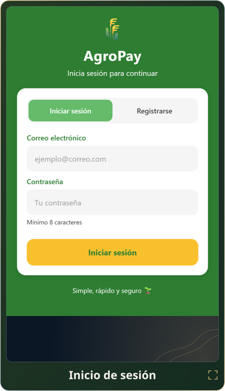
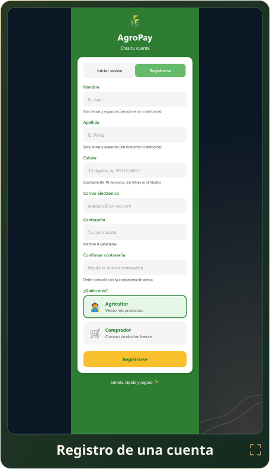

<p align="center">
  <picture>
    <source media="(prefers-reduced-motion: no-preference)" srcset="./docs/assets/banner-motion.svg">
    
  </picture>
</p>

<p align="center">
  <a href="#funcionalidades">Funcionalidades</a> · <a href="#tecnologías">Tecnologías</a> · <a href="#ejecutar-en-local">Ejecutar en local</a> · <a href="#capturas">Capturas</a>
</p>

Aplicación móvil que conecta agricultores y compradores. Reúne publicación de productos, stock, pedidos y revisión de comprobantes en un flujo adaptado a cada rol.

## Funcionalidades

- **Agricultor.** Publica productos, administra existencias, revisa pedidos y marca entregas.
- **Comprador.** Explora el mercado, crea pedidos y adjunta comprobantes mediante QR, cámara o imagen.
- **Seguimiento.** Presenta novedades del mercado, pedidos recientes y cambios de estado.
- **Validación de comprobantes.** Usa OCR y datos del QR para comprobar monto y referencia. El agricultor revisa los comprobantes que pasan al flujo de confirmación.
- **Precios de referencia.** Consulta la lista publicada por EP-EMA para el panel del agricultor.

## Tecnologías

| Tecnología | Uso |
| --- | --- |
| Expo SDK 54, React Native 0.81 y React 19 | Aplicación móvil y vista web de desarrollo |
| React Navigation y AsyncStorage | Navegación por rol y persistencia de sesión |
| Node.js y Express 4 | API de autenticación, productos, mercado y pedidos |
| MongoDB y Mongoose 8 | Usuarios, productos, disponibilidad y pedidos |
| JWT y bcrypt | Autenticación y gestión de contraseñas |
| Tesseract.js | Extracción de texto de comprobantes |

## Ejecutar en local

Necesitas **Node.js 20.19.4 o superior** con npm, **MongoDB** local o remoto y un cliente Expo compatible con el SDK del proyecto para probar en móvil.

### Iniciar la API

Abre una terminal en la raíz del repositorio.

```powershell
cd backend
npm ci
if (-not (Test-Path .env)) { Copy-Item .env.example .env }
```

Configura `MONGO_URI`, `JWT_SECRET` y, si necesitas otro puerto, `PORT` en `backend/.env`.

```bash
npm run dev
```

La API usa el puerto `3000` de forma predeterminada. Comprueba la respuesta en [`/health`](http://localhost:3000/health).

### Iniciar la aplicación

En otra terminal desde la raíz, ejecuta el servidor de Expo.

```bash
cd frontend
npm ci
npm start
```

**Navegador.** Pulsa `w` en Expo o ejecuta `npm run web` desde `frontend/`.

**Teléfono.** Conecta el teléfono y el computador a la misma red. Si la detección automática no alcanza la API, pon `EXPO_PUBLIC_API_URL` en `frontend/.env` con la dirección LAN del computador y el puerto del backend. Usa el origen completo, por ejemplo `http://192.168.1.20:3000`, y reinicia Expo. `EXPO_PUBLIC_API_PORT` permite ajustar el puerto de la detección automática.

## Compras y API

El comprador crea un pedido del catálogo con stock disponible y adjunta un comprobante. El pedido puede quedar `pre_validado` o `comprobante_enviado` para revisión. El agricultor confirma el pago, rechaza el comprobante o registra la entrega. Un rechazo devuelve las unidades reservadas al stock.

- **Autenticación** mediante `POST /api/auth/register` y `POST /api/auth/login`.
- **Productos del agricultor** en `/api/products`.
- **Mercado del comprador** en `/api/market`.
- **Compras y comprobantes** en `/api/orders`.
- **Revisión de pedidos** en `/api/farmer/orders`.
- **Precios de referencia** en `/api/farmer/referencia-precios`.

Las rutas de productos, mercado y pedidos requieren una sesión con el rol correspondiente.

## Estructura

- [`frontend/`](frontend) contiene la aplicación Expo.
- [`frontend/src/screens/`](frontend/src/screens) incluye las pantallas de acceso, mercado y pedidos.
- [`backend/routes/`](backend/routes) define los endpoints de la API.
- [`backend/models/`](backend/models) define los esquemas de MongoDB.
- [`backend/services/`](backend/services) reúne OCR, revisión de comprobantes y consulta de precios.

## Capturas

<p align="center">
  <a href="./docs/assets/capturas/agropay.png"></a>
  <a href="./docs/assets/capturas/agropay-registro.png"></a>
</p>
